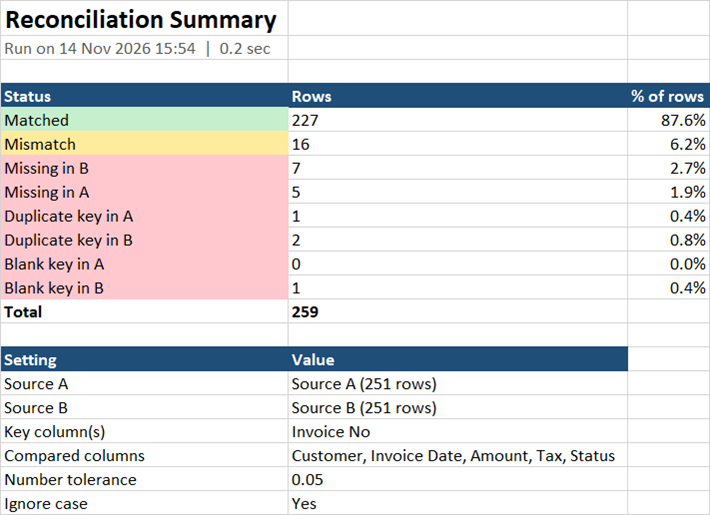
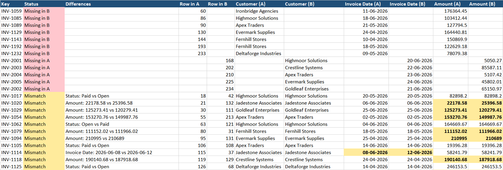

# Excel Data Reconciliation Tool (VBA)

Compare two datasets on a key and get a row-by-row answer: what matches, what differs (and in which column), and what is missing from either side.


---

## The Problem

Finance and operations teams constantly compare two versions of the "same" data: ERP invoices against the bank ledger, this month's master list against last month's, a vendor's statement against internal records.

The usual method is a column of `VLOOKUP`s and a lot of scrolling. It is slow, it misses records that exist only in the second file, and a difference of one paisa from rounding looks the same as a real error.

## The Solution

Paste the two datasets into **Source A** and **Source B**, name the key column on the **Settings** sheet and click **Reconcile**. Every row gets one status:

| Status | Meaning |
|---|---|
| ✅ Matched | Key found in both, all compared columns agree |
| ⚠️ Mismatch | Key found in both, but at least one column differs; the differences are listed |
| ❌ Missing in B | Key exists only in Source A |
| ❌ Missing in A | Key exists only in Source B |
| ❌ Duplicate key | The key appears more than once in the same source |
| ❌ Blank key | The key cell is empty |

## Features

| Feature | Details |
|---|---|
| 🔑 Flexible key | One column or several combined (for example `Invoice No, Line No`) |
| 🧭 Matches by header name | Columns can be in a different order in the two sources |
| 🔢 Number tolerance | Treat differences up to a chosen amount (such as 0.05) as equal, so rounding is ignored |
| 🔤 Smart text compare | Ignores case and stray spaces: `Apex Traders` equals ` APEX TRADERS ` |
| 📝 Explains every mismatch | `Amount: 125000 vs 127500; Status: Paid vs Open` |
| 🎨 Highlights | The cells that differ are highlighted, with A and B values side by side |
| 📊 Summary sheet | Counts and percentages by status, plus the settings used for the run |
| ⚡ Fast | Arrays and a dictionary lookup, not cell-by-cell `VLOOKUP`s |
| ⚙️ Settings-driven | Everything is set on a sheet; no code changes needed |

## Sample Run

The sample workbook holds 251 ERP invoices (Source A) and 251 ledger lines (Source B) with differences planted on purpose:

| Status | Rows | What was planted |
|---|---|---|
| Matched | 227 | Includes 4 rounding differences inside the tolerance and 6 names that differ only by case or spaces |
| Mismatch | 16 | 8 amounts, 5 statuses and 3 dates changed |
| Missing in B | 7 | Invoices not yet in the ledger |
| Missing in A | 5 | Ledger lines with no invoice |
| Duplicate key in A | 1 | An invoice entered twice |
| Duplicate key in B | 2 | Two ledger lines repeated |
| Blank key in B | 1 | A ledger line with no invoice number |

**Summary sheet:**



**Results sheet** (sorted by status): every mismatch names the column and both values, and the differing cells are highlighted.



## How to Use

1. Download `DataReconciliation.xlsm` and open it (click **Enable Content** if prompted)
2. Paste your data into **Source A** and **Source B**, with headers in row 1
3. On the **Settings** sheet:

| Setting | Example | Description |
|---|---|---|
| Source A sheet / Source B sheet | `Source A` | The sheets to compare |
| Key column(s) | `Invoice No` | Header name; separate several with commas |
| Columns to compare | *(blank)* | Leave blank to compare every column found in both sheets |
| Number tolerance | `0.05` | Numbers this close count as equal; use `0` for an exact match |
| Ignore case | `Yes` | `Yes` or `No` |

4. On the **Start** sheet, click **Reconcile**
5. Read the **Summary** sheet, then filter the **Results** sheet by Status

## Add It to Your Own Workbook

1. Press `Alt + F11`, then go to **File → Import File** and choose `src/modReconcile.bas`
2. Create a **Settings** sheet with the named ranges `SheetA`, `SheetB`, `KeyColumns`, `CompareColumns`, `NumberTolerance` and `IgnoreCase`
3. Run `Reconcile`

## Project Structure

```
excel-data-reconciliation/
├── DataReconciliation.xlsm   # ready-to-use workbook with sample data
├── src/
│   └── modReconcile.bas      # VBA source (readable on GitHub)
├── images/                   # screenshots for this README
├── README.md
└── LICENSE
```

## Roadmap

- [ ] Column mapping, for sources whose headers have different names
- [ ] Compare two separate workbooks without copying the data in
- [ ] Python version using pandas `merge`, for comparison

---

**Author:** [Swaminathan Narayanan](https://www.linkedin.com/in/swaminathan-narayanan-9781a7154/): Data Analytics | Excel & VBA Automation | Python | SQL | Power BI
